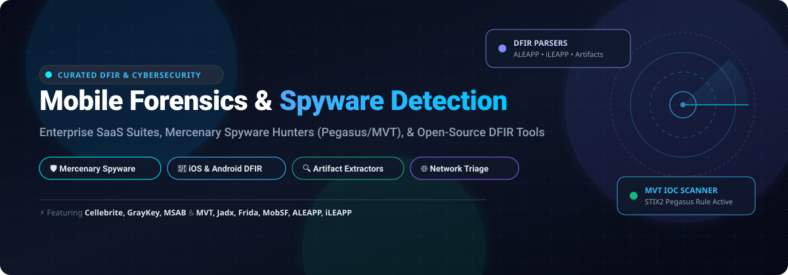
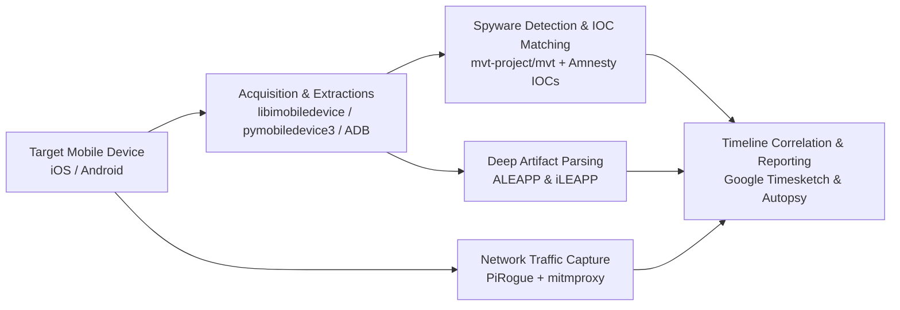

# 📱 Awesome Mobile Forensics & Spyware Detection 🔍

  

  <strong>Curated collection of SaaS/Commercial Forensics Platforms, Mercenary Spyware Triage Suites, and Open-Source Mobile DFIR Tools.</strong>

  <em>Specialized for iOS & Android evidence extraction, sysdiagnose inspection, Pegasus/Predator mercenary spyware hunting, and artifact analysis.</em>

---

## 📑 Table of Contents
- [🌐 Sector Overview & Market Dynamics](#-sector-overview--market-dynamics)
- [🏢 SaaS & Enterprise Commercial Platforms](#-saas--enterprise-commercial-platforms)
- [💻 Open-Source Mobile Forensics & Spyware Detection Projects](#-open-source-mobile-forensics--spyware-detection-projects)
- [🔬 Core Frameworks & Custom Lab Blueprints](#-core-frameworks--custom-lab-blueprints)
- [📈 Star History](#-star-history)
- [🤝 How to Contribute](#-how-to-contribute)
- [💖 Support & Sponsorship](#-support--sponsorship)
- [⚖️ Disclaimer](#️-disclaimer)

---

## 🌐 Sector Overview & Market Dynamics

The global **Digital Forensics and Incident Response (DFIR)** market—with mobile forensics and mercenary spyware threat defense as high-growth subsectors—is valued at approximately **$12.3 Billion to $14.8 Billion**, accelerating toward **$30+ Billion** by the early 2030s at an estimated compound annual growth rate (CAGR) of 11.5%–14.2%.

Market concentration exhibits a **highly concentrated, duopolistic tier at the high-end hardware extraction and lawful interception level** (dominated by Cellebrite and Magnet Forensics / Grayshift), combined with a **moderately fragmented ecosystem in cross-platform triage, Mobile Threat Defense (MTD), and forensic artifact analysis** where agile innovators and specialized labs compete.

---

## 🏢 SaaS & Enterprise Commercial Platforms

A comprehensive directory of leading commercial mobile forensics, enterprise mobile endpoint threat defense (MTD), and forensic investigative suites, sorted descending by company scale (valuation / annual revenue).

| 🏢 Platform / Vendor | 💰 Company Scale (Valuation / Revenue) | 🏷️ Starting Tier Pricing | 🎁 Free Tier Limit / Trial Model | 🎯 Primary Forensic & Spyware Capabilities |
| :--- | :--- | :--- | :--- | :--- |
| **[OpenText EnCase Mobile Investigator](https://opentext.com)** | ~$9.8B Market Cap (~$5.8B ARR) | From $3,500/year (per examiner workstation license) | 30-day full-featured enterprise evaluation trial upon sales verification; no permanent free tier | Comprehensive corporate e-discovery, enterprise smartphone evidence parsing, and remote endpoint triage integrated with enterprise DFIR pipelines. |
| **[Cellebrite UFED, PA & Guardian Cloud](https://cellebrite.com)** | ~$3.6B Market Cap (~$400M ARR) | From $6,000/year (UFED baseline software subscription) | 14-day government/enterprise verified evaluation license; strictly no permanent free tier | Global standard for physical and logical mobile extractions, passcode bypass, decrypting locked iOS/Android chipsets, and cloud evidence storage. |
| **[Lookout Mobile Endpoint Security](https://lookout.com)** | ~$1.5B Valuation (~$250M ARR) | From $4.50/device/month (Enterprise Threat Defense tier) | 14-day enterprise trial up to 50 mobile devices; Lookout Personal mobile app includes basic scanning for 1 device | Continuous zero-trust mobile endpoint detection and response (EDR), stalkerware identification, phishing interception, and real-time rogue profile detection. |
| **[Magnet Forensics (AXIOM Cyber & GrayKey)](https://magnetforensics.com)** | ~$1.8B Private Valuation (Thoma Bravo) | From $5,000/year (AXIOM Cyber annual examiner seat) | 30-day full functional trial for accredited law enforcement / enterprise incident responders; no permanent free tier | Industry-leading iOS/Android extraction via GrayKey appliance paired with deep forensic artifact analysis, memory carving, and timeline reconstruction in AXIOM. |
| **[Zimperium zIPS Mobile Threat Defense](https://zimperium.com)** | ~$525M Valuation (~$65M ARR) | From $3.00/device/month (billed annually, enterprise fleet) | 30-day proof-of-concept (PoC) evaluation for up to 100 enterprise endpoints; no permanent free tier | On-device machine-learning detection engine inspecting zero-day mobile exploits, malicious OS profiles, baseband anomalies, and network MITM tampering. |
| **[MSAB (XRY, XAMN & XEC Cloud)](https://msab.com)** | ~$75M Market Cap (Nasdaq Stockholm) | From $4,500/year (XRY Office forensic extraction bundle) | 14-day field evaluation trial for accredited digital forensics labs; no permanent free tier | High-speed mobile device data acquisition engine supporting fast logical, physical, and app-level extraction alongside centralized forensic case management. |
| **[Oxygen Forensics (Oxygen Forensic Detective)](https://oxygen-forensic.com)** | Private (~$35M–$45M ARR) | From $3,995/year (Detective single-user annual dongle/cloud seat) | 20-day evaluation trial with extraction limits (up to 5 device acquisitions); no permanent free tier | Deep mobile, drone, IoT, and cloud artifact forensics; decrypts WhatsApp, Telegram, Signal, and extracts geotagged timelines from encrypted smartphone backups. |
| **[Detego Unified Forensics Platform](https://detegoglobal.com)** | Private (~$20M–$30M ARR) | From $3,200/year (Detego Field Triage & Mobile kit) | 15-day evaluation license restricted to vetted military, LEA, and corporate forensic labs; no permanent free tier | Ultra-fast forensic imaging and field triage suite optimized for rapid mobile triage, automated evidence extraction, and instant alert indexing. |
| **[MOBILedit Forensic](https://mobiledit.com)** | Private (~$10M–$15M ARR) | From $2,490 one-time (Standard edition license for 1 PC) | Unlimited 7-day trial with data extraction watermark/export restrictions; MOBILedit Lite provides basic backup preview | Phone data recovery, deleted artifact extraction, forensic reporting, bypass of secure application sandbox barriers, and cross-device timeline comparison. |
| **[iVerify Enterprise](https://iverify.io)** | Series A (~$30M Valuation, Trail of Bits spin-out) | From $5.00/user/month (Enterprise Threat Hunting plan) | 14-day trial for corporate security teams; iVerify Basic iOS/Android app available as lifetime personal purchase ($2.99) | Specializes in detecting zero-click mercenary spyware (Pegasus, Predator, Graphite) through heuristic OS telemetry, anomalous system reboots, and log analysis. |

---

## 💻 Open-Source Mobile Forensics & Spyware Detection Projects

A curated, battle-tested list of open-source forensic utilities, artifact decoders, spyware hunting scripts, and mobile reverse-engineering platforms, **ranked in descending order by GitHub_Stars**.

| 📦 Repository & Tool | 🌟 Stargazers | 🛠️ Focus Area & Technical Profile |
| :--- | :---: | :--- |
| **[skylot/jadx](https://github.com/skylot/jadx)** |  | **Android Decompiler & Static Triage** Decompiles Android DEX, APK, and AAB files to readable Java source code with built-in deobfuscators, debugger integration, and string search for mobile malware analysts. |
| **[mitmproxy/mitmproxy](https://github.com/mitmproxy/mitmproxy)** |  | **Mobile Network Forensics & TLS Inspection** Interactive, SSL/TLS-capable intercepting HTTP/HTTPS/WebSocket proxy essential for uncovering hidden mobile beaconing, spyware telemetry, and unpinned network flows. |
| **[frida/frida](https://github.com/frida/frida)** |  | **Dynamic Binary Instrumentation Toolkit** Injects custom JavaScript snippets and hooks native APIs into running processes on Android and iOS to trace spyware function calls, bypass SSL pinning, and extract crypto keys. |
| **[MobSF/Mobile-Security-Framework-MobSF](https://github.com/MobSF/Mobile-Security-Framework-MobSF)** |  | **Automated Static & Dynamic Security Assessment** All-in-one framework for performing static analysis, malware scorecards, dynamic runtime testing, and permission audits on Android APKs, iOS IPAs, and Windows binaries. |
| **[mvt-project/mvt](https://github.com/mvt-project/mvt)** |  | **Mercenary Spyware Detection (Pegasus Hunter)** Flagship toolkit developed by Amnesty International Security Lab to analyze iOS backups, `sysdiagnose` dumps, and Android dumps for traces of Pegasus, Predator, and state-sponsored spyware. |
| **[VirusTotal/yara](https://github.com/VirusTotal/yara)** |  | **Rule-Based Pattern Matching Engine** The gold-standard malware signature matching utility used to classify malicious DEX bytecode, strings, iOS binary payloads, and stalkerware payloads. |
| **[sensepost/objection](https://github.com/sensepost/objection)** |  | **Runtime Mobile Exploration & Triage** Frida-powered CLI framework enabling mobile forensic examiners to dump Keychain data, inspect SQLite databases, and observe file operations without requiring jailbreak/root. |
| **[libimobiledevice/libimobiledevice](https://github.com/libimobiledevice/libimobiledevice)** |  | **Cross-Platform Apple iOS Protocol Library** Native open-source C library enabling examiners to communicate with iOS devices, trigger forensically sound unencrypted/encrypted backups, query device info, and read system syslog streams. |
| **[volatilityfoundation/volatility3](https://github.com/volatilityfoundation/volatility3)** |  | **Memory Forensics & Kernel Volatile Analysis** Next-generation volatile memory framework capable of dissecting Android Linux kernel dumps, extracting live processes, tracing hidden sockets, and finding in-memory rootkits. |
| **[sleuthkit/autopsy](https://github.com/sleuthkit/autopsy)** |  | **Graphical Digital Forensics Platform** Extensible GUI forensics platform supporting Android and iOS image ingestion, SQLite carving, EXIF metadata extraction, timeline visualization, and multi-user investigations. |
| **[google/timesketch](https://github.com/google/timesketch)** |  | **Collaborative Forensic Timeline Analysis** Open-source tool for collaborative timeline investigation; ingests timeline outputs from MVT, ALEAPP, and iLEAPP to correlate malicious system events across multiple mobile endpoints. |
| **[doronz88/pymobiledevice3](https://github.com/doronz88/pymobiledevice3)** |  | **Pure-Python iOS Protocol Engine & Extraction** Modern Python3 implementation of Apple device protocols supporting lockdown inspection, developer mode toggles, crash log dumping, diagnostic archive capture, and backup extraction. |
| **[rednaga/APKiD](https://github.com/rednaga/APKiD)** |  | **Android Packer & Obfuscator Identification** PEiD-equivalent for Android that scans APK files to pinpoint packers, compilers, obfuscators, anti-tampering SDKs, and commercial spyware evasion wrappers. |
| **[nelenkov/android-backup-extractor](https://github.com/nelenkov/android-backup-extractor)** |  | **Android ADB Backup Parser** Utility to extract and unpack encrypted or unencrypted Android `.ab` backup archives into standard `.tar` files for offline file-carving and artifact exploration. |
| **[jtsylve/LiME](https://github.com/jtsylve/LiME)** |  | **Linux & Android Memory Extractor** Loadable Kernel Module (LKM) allowing forensically sound RAM captures from Android and Linux devices over network or local flash without contaminating userspace state. |
| **[AmnestyTech/investigations](https://github.com/AmnestyTech/investigations)** |  | **Pegasus & Mercenary Spyware STIX2 IOCs** Verified indicators of compromise, network domains, and malware signatures curated by Amnesty Tech from real-world human rights defender and journalist spyware investigations. |
| **[den4uk/andriller](https://github.com/den4uk/andriller)** |  | **Android Forensic Triage & Acquisition Suite** Non-destructive acquisition toolkit performing read-only smartphone physical/logical triage, screen lock pattern decoding, and social communication database parsing. |
| **[abrignoni/iLEAPP](https://github.com/abrignoni/iLEAPP)** |  | **iOS Logs, Events, And Plists Parser** Flagship Python forensic parser extracting hundreds of iOS artifacts (KnowledgeC, Biome, Location, Safari, Photos, SMS, Health) from backups, extractions, and sysdiagnose. |
| **[abrignoni/ALEAPP](https://github.com/abrignoni/ALEAPP)** |  | **Android Logs Events And Protobuf Parser** Forensic engine for parsing Android artifacts (app usage stats, Bluetooth connections, cell towers, Chrome history, WhatsApp DBs) into clean HTML and TSV reports. |
| **[KasperskyLab/triangle_check](https://github.com/KasperskyLab/triangle_check)** |  | **Operation Triangulation iOS Spyware Scanner** Automated Python scanner specifically designed to parse iOS backups and identify indicators of compromise related to the sophisticated Operation Triangulation zero-click spyware. |
| **[AssoEchap/stalkerware-indicators](https://github.com/AssoEchap/stalkerware-indicators)** |  | **Consumer Stalkerware & Spying App Indicators** Maintained collection of known stalkerware package names, application hashes, and C2 servers used by domestic spyware to track targets without consent. |
| **[dod-cyber-crime-center/DC3-MWCP](https://github.com/dod-cyber-crime-center/DC3-MWCP)** |  | **Malware Configuration Parser Framework** Standardized framework from the DoD Cyber Crime Center for extracting C2 endpoints and configuration parameters from unpacked mobile malware payloads. |
| **[cclgroupltd/ccl_chromium_reader](https://github.com/cclgroupltd/ccl_chromium_reader)** |  | **Mobile Chrome & IndexedDB Forensic Reader** Specialized forensic parser decoding Chromium LevelDB, SNSS sessions, and IndexedDB artifacts from modern Android browsers and webview-based mobile spyware. |
| **[PiRogueToolSuite/pirogue-os](https://github.com/PiRogueToolSuite/pirogue-os)** |  | **Hardware-Assisted Mobile Network Forensics OS** Debian-based OS image for the PiRogue device, providing a dedicated hardware access point that intercepts, records, and decrypts cellular and Wi-Fi traffic from suspect phones. |
| **[PiRogueToolSuite/pirogue-cli](https://github.com/PiRogueToolSuite/pirogue-cli)** |  | **PiRogue Command-Line Automation Tool** Command-line controller to orchestrate traffic captures, socket attribution, and STIX2 threat correlation across connected iOS and Android test targets. |

---

## 🔬 Core Frameworks & Custom Lab Blueprints

For building an autonomous, end-to-end mobile forensic and spyware analysis laboratory without proprietary vendor lock-in:

- **Spyware Detection**: Pair **[mvt-project/mvt](https://github.com/mvt-project/mvt)** with **[AmnestyTech/investigations](https://github.com/AmnestyTech/investigations)** and **[triangle_check](https://github.com/KasperskyLab/triangle_check)** to flag Pegasus and Triangulation compromises.
- **Artifact Parsing**: Run **[abrignoni/iLEAPP](https://github.com/abrignoni/iLEAPP)** and **[abrignoni/ALEAPP](https://github.com/abrignoni/ALEAPP)** to turn raw databases into parsed HTML/CSV investigative timelines.
- **Dynamic Inspection**: Use **[frida/frida](https://github.com/frida/frida)** and **[sensepost/objection](https://github.com/sensepost/objection)** for runtime tracing, SQLite extraction, and memory exploration.
- **Network Forensic Gateway**: Intercept cellular and Wi-Fi beacons using **[PiRogueToolSuite/pirogue-os](https://github.com/PiRogueToolSuite/pirogue-os)** and **[mitmproxy/mitmproxy](https://github.com/mitmproxy/mitmproxy)** to catch zero-click C2 communications.

---

## 📈 Star History

---

## 🤝 How to Contribute

Contributions from DFIR analysts, cybersecurity researchers, and developers are warmly welcomed! 🌟

1. **Fork** this repository.
2. **Add/Edit** entries in `README.md` (keep descriptions clear, objective, and link directly to official repositories/sites).
3. If adding a SaaS product, include exact starting tier pricing, trial limits, and valuation/revenue details.
4. If adding an open-source tool, provide the GitHub repo handle and a social style Stars_Badge.
5. **Submit a Pull Request** describing your additions.

---

## 💖 Support & Sponsorship

Thank you for visiting and using this curated mobile forensics resource! 🙏 If you find this directory valuable for your investigative work or research, please consider:

- ⭐ **Starring this repository** on GitHub to increase visibility for incident responders!
- 🍴 **Forking and sharing** it with your fellow security engineers and DFIR communities.
- ☕ **Sponsoring or buying a coffee** via the [GitHub Sponsor Dashboard](https://github.com/sponsors/ishandutta2007) to help support continuous curation and updates!

---

## ⚖️ Disclaimer

- This repository is a community-curated educational and technical resource—not a formal legal endorsement or warranty.
- Digital forensics, traffic interception, and spyware detection tools must only be operated on hardware you own or have explicit, documented legal authorization to investigate. Unauthorized extraction or interception of mobile device telemetry violates global computer-crime, wiretapping, and privacy statutes.
- Sophisticated zero-click mercenary spyware frequently runs entirely in volatile RAM and cleans forensic artifacts upon termination; a clean scan from MVT or any forensic utility reduces risk probability but does not constitute an absolute guarantee of non-compromise. Always maintain strict chain-of-custody hashes (SHA-256) when preserving evidentiary artifacts.
